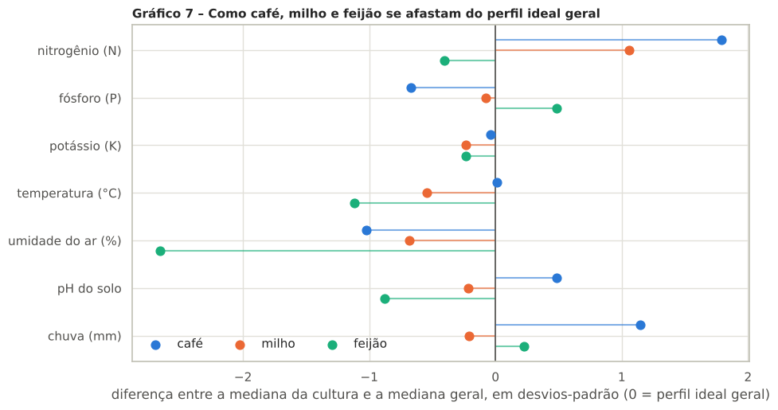
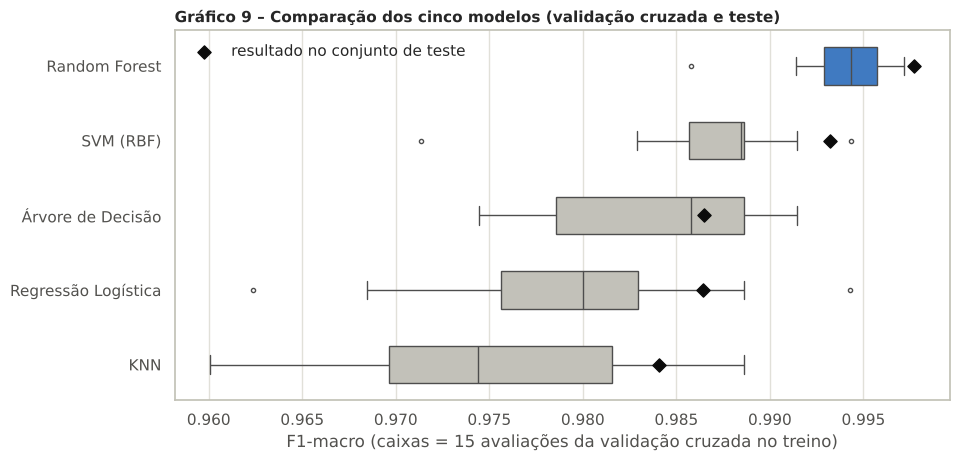

# FIAP - Faculdade de Informática e Administração Paulista

<p align="center">
<a href= "https://www.fiap.com.br/"></a>
</p>

<br>

# Modelagem de IA da FarmTech Solutions

## FarmTech Solutions — Turma 1TIAOR

## 👨‍🎓 Integrantes:
- Tiago Mendes Lanna — RM575734
- João Emanuel Hamacek de Paiva — RM575616
- Leandro de Oliveira Carvalho — RM576043

## 📜 Descrição

Atividade do **Capítulo 11 da Fase 3** da Graduação em Inteligência Artificial. A FarmTech Solutions quer indicar ao produtor **qual cultura plantar** a partir das condições do solo e do clima. Para isso, analisamos a base `produtos_agricolas.csv`, com 2.200 registros de 22 culturas e 7 variáveis: nitrogênio (N), fósforo (P), potássio (K), temperatura, umidade do ar, pH do solo e chuva.

O trabalho está no notebook [`src/Modelagem de IA da FarmTech Solutions - TiagoMendesLanna_RM575734_fase3_cap11.ipynb`](src/Modelagem%20de%20IA%20da%20FarmTech%20Solutions%20-%20TiagoMendesLanna_RM575734_fase3_cap11.ipynb), já executado, e tem quatro partes:

1. **Análise exploratória:** estrutura, qualidade dos dados, distribuições e valores extremos. A base é limpa e balanceada (100 amostras por cultura, sem valores ausentes nem duplicatas). Os valores extremos representam culturas exigentes, como maçã e uva em fósforo e potássio e arroz em chuva, e foram mantidos.
2. **Análise descritiva**, com gráficos e os principais achados. As variáveis são quase independentes entre si (a correlação de 0,74 entre P e K vem só de maçã e uva), e **umidade do ar, chuva e nitrogênio** são as variáveis que mais diferenciam as culturas.
3. **Perfil ideal de solo e clima** e comparação de **café, milho e feijão**, com testes de Mann-Whitney e Kruskal-Wallis e tamanho de efeito (delta de Cliff). O perfil ideal geral é N ≈ 37, P ≈ 51, K ≈ 32, 25,6 °C, 80% de umidade do ar, pH 6,4 e 95 mm de chuva. O café pede mais nitrogênio e chuva, o milho é o mais próximo do perfil geral e o feijão é o mais distante (ar seco, clima ameno e solo ácido).
4. **Cinco modelos preditivos:** Regressão Logística, KNN, SVM, Árvore de Decisão e Random Forest. Seguimos as boas práticas de Machine Learning: divisão estratificada entre treino e teste, pipelines sem vazamento de dados, busca de hiperparâmetros com validação cruzada, comparação por validação repetida, baseline, análise de erros e importância das variáveis. Os cinco passaram de 98% de acurácia no teste. O melhor foi o **Random Forest**, com **99,8% de acurácia (1 erro em 440 amostras)**.

O notebook termina com as conclusões, os pontos fortes e as limitações do trabalho.

### Alguns resultados

<p align="center"></p>

<p align="center"></p>

## 📁 Estrutura de pastas

Dentre os arquivos e pastas presentes na raiz do projeto, definem-se:

- <b>assets</b>: imagens do projeto. Em `assets/graficos` estão os 11 gráficos gerados pelo notebook.
- <b>src</b>: o notebook da atividade (`.ipynb`, já executado) e a base `produtos_agricolas.csv`, que o notebook lê.
- <b>requirements.txt</b>: bibliotecas Python usadas.
- <b>README.md</b>: este arquivo, com a explicação geral do projeto.

## 🔧 Como executar o código

O notebook já está salvo com todas as células executadas, então basta abri-lo no GitHub para ver os resultados. Para executá-lo de novo:

**No Google Colab:**
1. Abra [colab.research.google.com](https://colab.research.google.com) e use *Arquivo → Fazer upload de notebook* com o arquivo da pasta `src`.
2. No painel *Arquivos* (ícone de pasta, à esquerda), envie também o `produtos_agricolas.csv`.
3. Use *Ambiente de execução → Executar tudo*.

**No computador (Python 3.10 ou mais recente):**
```bash
pip install -r requirements.txt
cd src
jupyter notebook
```
Depois abra o notebook e use *Kernel → Restart & Run All*. A execução leva cerca de 1 minuto.

## 🗃 Histórico de lançamentos

* 1.0.0 - 11/11/2026
    * Entrega da atividade do Capítulo 11 (Fase 3): análise exploratória e descritiva, perfil ideal com café, milho e feijão, e cinco modelos preditivos.

## 📋 Licença

<p xmlns:cc="http://creativecommons.org/ns#" xmlns:dct="http://purl.org/dc/terms/"><a property="dct:title" rel="cc:attributionURL" href="https://github.com/agodoi/template">MODELO GIT FIAP</a> por <a rel="cc:attributionURL dct:creator" property="cc:attributionName" href="https://fiap.com.br">Fiap</a> está licenciado sobre <a href="http://creativecommons.org/licenses/by/4.0/?ref=chooser-v1" target="_blank" rel="license noopener noreferrer" style="display:inline-block;">Attribution 4.0 International</a>.</p>

## Repositório e entrega

Repositório público: https://github.com/joaohamacek/FarmTech-FIAP-Fase3-Cap11

As pastas `config/`, `scripts/` e `document/` complementam a organização do modelo FIAP. O arquivo `document/ENTREGA_PORTAL.txt` contém o link para entrega. Confira os requisitos específicos no enunciado oficial antes da submissão.
